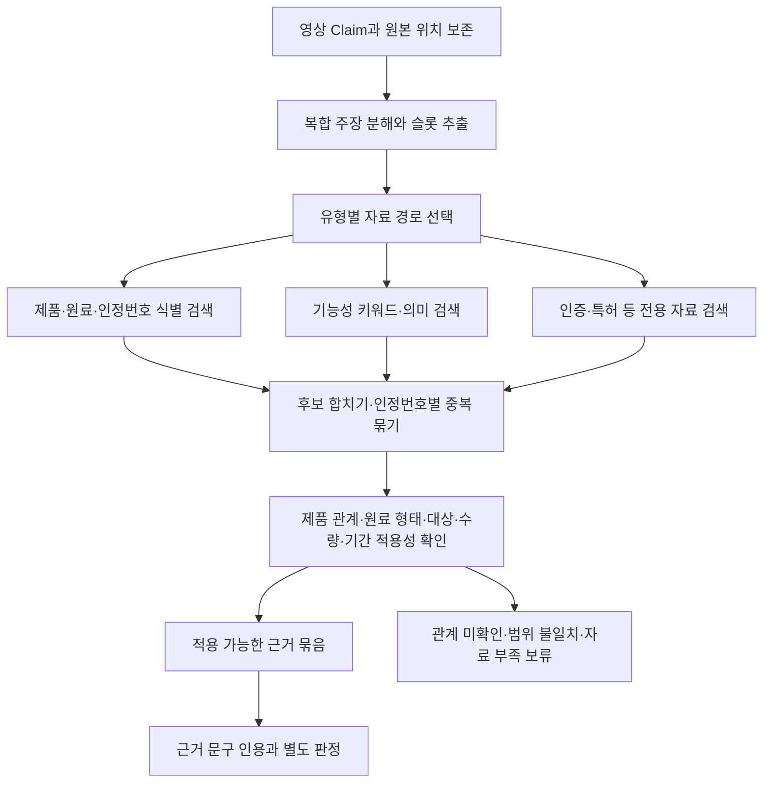

# TRUEAD Claim–Evidence 매핑 설계 및 실제 DB 조회 사례

작성일: 2026-10-15 (Asia/Seoul)

## 결론

제품명 우선 → 성분명 차선 같은 고정 단계 대신, Claim을 검증 가능한 작은 주장으로 나눈 다음
주장 유형에 맞는 데이터에서 제품·원료 식별 검색과 기능성 검색을 병렬로 수행한다.
검색 후보와 해당 제품에 적용 가능한 근거를 분리하고, 연결이 확인되지 않으면 보류한다.
유사한 문장이 검색됐다는 사실은 광고 주장 지지나 반박 판정이 아니다.

## 검토 범위와 실행 여부

- 제공한 15개 Claim과 21쪽 발표 PDF를 읽었다.
- 로컬 SQLite 두 개를 읽기 전용으로 조회했다. 서버 DB의 최신 상태는 조회하지 않았다.
- PDF 2~3쪽에는 서버 DB 복원과 조회 환경 구축 완료가 보고되어 있다. 이는 발표자료의 기술이다.
- 조사 과정에서 DB 쓰기, 광고 다운로드, 신규 API 수집, 임베딩 생성, LLM 판정은 수행하지 않았다.
- `scripts/audit_claim_mapping.py`는 재현 가능한 SQL 범위 점검 도구다. 자동 매핑 엔진이 아니다.
- 결과: `docs/claim_mapping_audit.json`. 원본 입력 해시와 실제 후보 ID·본문·출처를 기록했다.
- 제공 텍스트는 최상위 중괄호가 생략됐고 일부 후행 쉼표가 있어, 감사용 메모리 사본에서만
  JSON 문법을 보정했다. 원본 파일·문구·타임스탬프는 변경하지 않았다.

## 1. 현재 DB에서 실제로 확인한 문제

| 항목 | 조회 결과 | 설계에 주는 의미 |
|---|---|---|
| products의 정규화 제품명 `알파아이` | 0건 | 제품 identity를 확정할 수 없음. 미등록·불법·거짓이라는 결론은 불가 |
| ingredients의 `초유`, `CBP`, `YGF`, `칼슘` 부분검색 | 각각 0건 | 현재 원료 목록만으로 전체 원료를 포괄하지 못함 |
| `한속단` | ingredient_id=768, 블랙라즈베리한속단추출복합분말 | YGF-251과 같은 물질로 확정 불가. 기능성·섭취량도 공란 |
| `홍삼` 정확 이름 | ingredient_id=593, 인정번호 2024-20 | 이 행의 기능성은 혈당 조절. 모든 홍삼 일반 기능성으로 확대하면 안 됨 |
| 키 성장/성장판 기능성 검색(공백 제거) | Evidence 6행 | 인정번호 기준 중복 묶음 4개. 제품 함유 연결은 별도 필요 |
| 제품 기능성의 `[칼슘]` | 다른 제품에서 발견 | 일반 개념 후보이나 알파아이의 기능성·함량 근거로 재사용 불가 |
| 특허 `compound K` | 제목/초록 57건 | 검색 후보 수. 제품 사용·권리 상태·인체효과 확인을 뜻하지 않음 |
| 특허 `Rh2` | 제목/초록 106건 | 동일 |
| 특허 `성장판` | 제목/초록 2건 | 유사 주장이 있는 기술 문서일 뿐 공식 기능성 인정·임상 입증 아님 |

이 결과는 현재 로컬 스냅샷에 한정된다. `카이스트` 같은 한 표현의 검색 실패를
기관의 정식 이름·다른 명칭까지 포함한 부재로 해석하지 않는다.

실제 실패 사례: products에서 `%초유%`로 검색하면 `닥터S태초유산균`도 나온다.
단순 부분문자열 매칭을 원료 함유나 제품 동등성으로 확정하면 안 된다.

현재 evidence는 공식 기능성·섭취량·주의사항 3종만 허용한다.
HACCP 인증, 원산지, 박사 학위, 협업 관계, 실제 제품 배합량은 이 테이블로 직접 검증할 수 없다.

## 2. 입력 처리: 광고 원문과 검증 근거를 구분

입력 JSON의 `evidence.audio/visual`은 광고에서 그 말을 어디서 추출했는지 나타내는 자료다.
사실 검증 DB의 evidence와 혼동하지 않는다. 원본 키는 보존하고 내부에서는
`extraction_provenance`와 `verification_evidence`라는 별도 개념으로 다룬다.

기존 claims.claim_id는 정수이고 입력은 c01처럼 문자열이다.
`(video_id, external_claim_id)`로 원본을 식별하고 정수 PK와 연결해야 다른 영상의 c01과 충돌하지 않는다.
시간·화면 프레임·음성 segment·scope·types·target·dup_of·conflict 전체를 원본 JSON으로 보존한다.
기존 claims 테이블만으로는 이 모든 정보를 담을 수 없다.

### 원자 주장 분리

예: c09의 한 문장을 다음으로 나눈다.
- c09.1: 제품이 CK를 함유한다. → 제품 성분/배합 자료 필요
- c09.2: 해당 성분/기술에 특허가 있다. → 특허 번호·대상·권리 상태 필요
- c09.3: 홍삼의 효능을 100배 늘린다. → 무엇 대비 어떤 효과인지와 정량 인체 근거 필요

원문, 파생 문장, 추론으로 보완한 문맥을 분리한다. 한 부분이 확인돼도 원문 전체를 지지하지 않는다.
types는 검색 힌트이며 확정 라벨이 아니다. c04는 인증만 태깅됐지만 공법·성분 함유 주장도 있다.
c02는 수치이면서 포장/규격 주장이다. c08·c14는 types가 없어도 원료 식별 단서로 사용할 수 있다.

### 검증 슬롯

제품 후보 / 원료 후보 / 대상 집단 / 기능성 / 주장 강도 / 수량 / 단위 / 섭취 기준 /
비교 대상 / 기간 / 인증기관·종류 / 특허 번호 / 시간·화면 출처 / 미확정 슬롯을 기록한다.

- 300mg 원료분말과 300mg 지표성분을 같다고 보지 않는다.
- 12,000mg이 병 전체인지 1회·1일 분량인지 모르면 비교를 보류한다.
- c02는 1,000mg × 30정 = 30,000mg = 30g이라는 내부 산술 일관성만 확인 가능하다.
  실제 포장 사실은 아직 검증하지 못한다. 이 수치를 다른 Claim의 기준량으로 자동 전파하지 않는다.
- C-kd를 CK로 자동 교정하지 않는다. 후보로 제안하고 원본 프레임에서 확인한다.
- 180은 키 맥락 후보지만 cm 단위와 기간을 확인 없이 사실값으로 보충하지 않는다.
- c13은 잘린 문장이다. 주변 원문을 재확인하기 전 완성된 효과 문장으로 단정하지 않는다.
- 동일 영상/target/시간 근접 정보는 문맥 후보를 만들 뿐, 성분 함유의 독립 검증 자료가 아니다.
- scope=OUT_OF_SCOPE와 원료명 단편도 삭제하지 않는다. 판정 제외와 검색 문맥 활용 여부를 구분한다.

## 3. Claim 유형별 검색 경로

| 원자 주장 | 우선 확인할 자료 | 현재 DB의 역할/제약 |
|---|---|---|
| 제품 정체·규격 | 보고번호, 제조사, 제품명, 라벨 | products. 이름만 일치하면 후보, 보고번호·제조사로 동일성 검증 |
| 원료 함유·함량 | 제품별 배합/성분표·검사자료 | 제품–원료 함량 테이블이 없음. 공식 일일섭취량으로 대체 금지 |
| 기능성·효과 | 적용 가능한 원료의 OFFICIAL_FUNCTIONALITY | 질환·대상·원료 형태·인정번호·주장 강도를 함께 비교 |
| 섭취 기준 | OFFICIAL_INTAKE + 원료별 정량기준 | 배합량·지표성분량·1회/1일/전체량 구분 |
| 안전·주의 | OFFICIAL_PRECAUTION | 효능 지지 근거로 사용하지 않음 |
| 인증 | 기관별 인증대장·사업장·기간·범위 | 현재 미보유. HACCP를 원료 인정번호로 대체 금지 |
| 특허 | 특허 번호·권리 상태·기술 내용·제품 관계 | kipris 제목/초록 후보. 원문 청구항·실시예 등이 추가로 필요할 수 있음 |
| 원산지·인물·협업·사용 경험 | 해당 사실을 확인할 별도 출처 | 현재 미보유/검증범위 정책 필요 |
| 질병 개념 | diseases 명칭·코드 | 이름 정규화에만 사용. 질병 코드로 치료 효과를 입증하지 않음 |

## 4. 후보 생성은 병렬, 적용성 검증은 필수



### 식별 검색
보고번호·인정번호·특허번호처럼 명확한 식별자를 우선 신뢰한다.
정규화 이름+제조사, 정식 이름+허가된 별칭을 후보 확장에 사용한다.
짧은 CBP·CK, 상표명·화합물명은 별칭 사전에 범위·출처를 기록하고 임의 합치기를 금지한다.
홍삼과 홍삼오일·효소처리분말, 단일 원료와 복합추출물은 서로 다른 identity다.
인정번호 2024-26과 제2024-26호는 형식 정규화로 묶되 모든 원본 row·출처는 보존한다.
추출물명 오탈자와 OCR 변형은 fuzzy 후보로만 제시한다.

### 기능성 검색
키워드 검색과 pgvector 의미 검색을 함께 사용한다.
예: `키 성장`, `키성장`, `성장판`, `신장 증가`는 검색 확장 후보이지 의미가 같은 효과는 아니다.
원문 표현과 검색 확장어를 별도 보존하고 최종 적용성 검증에서 차이를 다시 확인한다.
한국어 검색은 공백·문장부호 정규화, 도메인 사전, PostgreSQL pg_trgm을 우선 검토한다.
PostgreSQL 기본 영문 형태소 검색만으로 한국어 BM25 검색이 된다고 가정하지 않는다.

임베딩 입력에는 단순 evidence_text뿐 아니라 원료 정식명·인정번호·유형·조건을 포함한다.
근거 원문은 유지하고 청크마다 evidence_id와 원문 위치를 기록한다.
외부에서 조회한 텍스트나 특허 내용을 LLM에 지시문으로 실행하지 않는다.

### 후보 결합과 재정렬
제안 초기값: 식별 결과 + 키워드 상위 30개 + 벡터 상위 30개 → 중복 묶기 → 10개 재정렬 → 3~5개 검토.
이는 실측 최적값이 아니라 평가할 출발점이다. 확정 식별자는 순위 점수로만 경쟁시키지 않고 별도 보존한다.
키워드 점수와 코사인 점수는 직접 더하지 않고 RRF 같은 순위 결합 방식을 사용할 수 있다.
Cross-Encoder/LLM 재정렬은 관련성 평가이며 지지/반박 판정과 분리한다.
처음에는 작은 후보군에서 적용성 규칙을 먼저 구현하고 재정렬 도입 효과를 평가한다.

## 5. 적용성 판정 기준

근거마다 다음 상태를 따로 기록한다.
- retrieval_status: 후보 있음 / 후보 없음 / 해당 자료 미보유 / 입력 재확인 필요
- applicability: 적용 가능 / 동일성·함유 관계 미확인 / 범위 불일치 / 불명
- evidence_role: 직접 제품 자료 / 원료 기준 / 비교 문맥 / 특허 보조 자료
- relation: 관련 주제 / 일부 요소 지지 / 지지 / 반박 / 판단 불가

다른 제품의 기능성 문장을 원료 공식 기준으로 자동 승격하지 않는다.
제품이 확정되지 않아도 원료 수준 검색은 가능하지만 결과의 범위를 원료 수준으로 표시한다.
대상·섭취량이 없다는 이유로 후보를 버리기보다 미확인 슬롯을 표시해 보류한다.
명확히 다른 원료·제품의 근거는 직접 지지 근거에서 제외한다.
수면 도움과 키 성장, 흡수율과 효능, 성분 생성량과 임상 효과, 뼈 건강과 성장판 활성화를 구분한다.
상충 근거·조건·주의사항도 함께 가져오고 긍정 문장만 모으지 않는다.

후보 없음이나 미보유는 거짓이 아니다. INSUFFICIENT 같은 증거 부족 상태를 시스템 내부에는 유지한다.
CONTRADICTED는 같은 대상·조건의 주장과 반대되는 적극적 근거가 있을 때만 사용한다.
SUPPORTED도 근거가 실제로 다루는 원자 주장과 범위에 한정한다.
검색 점수·LLM 관련성·판정 확신도를 하나의 confidence로 섞지 않는다.

## 6. 제공된 15개 Claim을 적용했을 때

아래는 실제 DB 조회 결과에 기초한 설계상 연결 예시다. 자동 매핑/판정 완료 결과가 아니다.

| Claim | 분해/검색 경로 | 현재 데이터로 연결되는 범위 |
|---|---|---|
| c01 HACCP | 인증 대상 사업장·번호·제품 관계·기간 | 인증 자료 미보유. 공식 기능성 Evidence로 연결하지 않음 |
| c02 1,000mg×30T(30g) | 단위·포장수량·산술 검사 → 대상 제품 규격 | 산술은 일치. 실제 포장·제품 사실 미확인. OFFICIAL_INTAKE로 연결 금지 |
| c03 KAIST 박사·특허원료·공동개발 | 자격 / 특허 존재 / 제품 협업 관계로 분리 | 제품·인물·특허 번호 미확정. 관련 특허가 나와도 학위·협업은 입증 못 함 |
| c04 신기술 인증·효소공법·C-kd/Rh2 함유 | 인증 / 제조공법 / 성분 함유로 분리 | Rh2 특허 후보 106건. C-kd는 OCR 재확인. 제품 사용·인증 별도 필요 |
| c05 CBP 300mg | 원료 식별·제품 함유·기준량 확인 | 원료명 후보 미발견. 제품별 함량 자료 필요 |
| c06 뉴질랜드 우유칼슘 12,000mg | 원산지 / 원료 함유 / 함량 분리 | 칼슘 기능성의 다른 제품 문맥은 있어도 직접 근거 아님. 원산지·분말/원소량·기준량 미확인 |
| c07 네덜란드 산양유분말 600mg | 원산지 / 함유 / 함량 | 현재 원료 기준 Evidence로 검증 불가. 별도 라벨·배합·원산지 자료 필요 |
| c08 한속단달개비추출분말 YGF-251 | 복합원료 정체·동의어 후보 | ingredient 768은 한속단을 포함하지만 다른 복합원료. 확정 매핑 금지 |
| c09 CK 함유·특허·효능100배 | 함유 / 특허 / 비교효능 분리 | compound K 특허 57건 후보. 제품 함유·권리·비교효능을 각각 확인해야 함 |
| c10 성장판 빠른 활성화 | 기능성+기전+속도 | 키 성장 공식 Evidence 6행은 비교 후보. 알파아이 적용과 성장판 기전·속도는 미확인 |
| c11 팔다리 성장이 눈에 보임 | 신체 성장·효과 크기·기간 | c10과 근거 묶음 공유 가능하나 별도 주장 유지. 정량 효과·기간 미확인 |
| c12 연예인 자녀 복용 | 제품 사용 사실 / 현재 scope 정책 | OUT_OF_SCOPE 원문 보존. 범위 제외 또는 별도 사실 확인, 효능 Evidence 사용 금지 |
| c13 잘 놀고 잘 자는 데 도움을 줄 수 있 | 잘린 문장 재확인 → 활동·수면 분리 | 수면 기능성 후보는 있지만 해당 원료 함유 관계 미확인. 문장 자동 완성 금지 |
| c14 CBP 우유칼슘 | 성분 식별 문맥 | 독립 효능 주장으로 만들지 않음. c05/c06 검색 문맥을 보조하지만 함유 입증은 아님 |
| c15 제품 섭취 후180 | 개인 경험 / 키 수치 / 기간 / 인과관계 | 성장 관련 기준으로 개인 결과·제품 인과를 입증 못 함. 외부 비교 자료와 원문 재확인 필요 |

### 실제 ID를 이용한 대표 경로 A: c10

`성장판 활성화` → 기능성 개념 검색 → 다음 후보가 조회된다.

| evidence_id | 원료/인정번호 | 저장된 기능성 |
|---|---|---|
| 1729 | 유산균발효굴추출물(FGO), 2024-26 | 어린이키성장에 도움을 줄 수 있음 |
| 1737 | 유산균발효굴추출물(FGO), 2024-27 | 어린이 키성장에 도움을 줄 수 있음. |
| 2234 | 황기추출물 등 복합물(HT042), 제2014-40호 | 어린이 키성장에 도움을 줄 수 있음 |
| 2813 | FGO, 제2024-26호 | 어린이 키성장에 도움을 줄 수 있음 |
| 2816 | FGO, 제2024-27호 | 어린이 키성장에 도움을 줄 수 있음 |
| 2945 | 한삼덩굴추출분말(HSy2), 제2025-41호 | 어린이 키성장에 도움을 줄 수 있음 |

1729/2813, 1737/2816은 인정번호별로 묶어 과대 집계하지 않는다.
현재 입력에는 HT042/FGO/HSy2가 제품에 포함됐다는 자료가 없다.
따라서 `TOPIC_RELATED + PRODUCT_INGREDIENT_LINK_UNVERIFIED`로 보류한다.
`키 성장에 도움` 문구로 `성장판이 빠르게 활성화`까지 지지하지 않는다.
YGF-251을 HT042로 이름만 비슷하다는 이유로 매핑하면 안 된다.

### 실제 경로 B: c09

`CK`를 원문 확인 및 사전 검토 후 `compound K` 후보로 검색하면 관련 특허가 나온다.
실제 제목 예: 출원번호 1020200155911, `홍삼, 효소 및 천연물을 이용한 컴파운드 K의 제조방법`.
초록은 성분 생성량 증가를 설명하지만 인체 효능 100배와 같은 지표가 아니다.
제품이 이 특허를 사용하는지도 확인되지 않았다.
따라서 특허 보조 후보로만 연결하며 함유·특허 관계·효능100배는 미확정이다.

`홍삼` 이름으로 찾은 evidence_id=1557은 특정 인정번호의 혈당 조절 기능성이다.
홍삼이라는 공통 단어가 있다는 이유로 성장이나 100배 효능에 지지 근거로 연결하지 않는다.

## 7. 저장 구조 제안: 기존 테이블은 보존, 후보와 판정 분리

새 스키마/테이블 이름은 제안이며 이번에 생성하지 않았다.

| 제안 구조 | 필요한 정보 |
|---|---|
| claim_inputs | video_id+외부 claim_id 고유키, 원본 JSON, 시간·화면·음성 출처, 기존 claims PK |
| claim_atoms | 원자 주장, 원문 부모, 슬롯 JSON, 추출 모델/버전, 미확인 항목 |
| entity_aliases | 원료·제품 canonical 식별자, 별칭, 인정번호 정규화, 출처·검수 상태 |
| product_ingredient_links | 제품–원료 관계, 보고/인정번호, 배합/지표성분량, 기준량, 출처·확인 상태 |
| evidence_documents | 원본 테이블·PK·필드·문구 위치·문서 해시·효력/조회 시각을 가리키는 공통 근거 참조 |
| retrieval_runs / candidate_links | 원자 Claim–근거 후보, 검색어·방법·순위·점수, 적용성·보류 사유, 채택 여부 |

evidence_documents는 기존 evidence 행, 제품 필드, 특허, 추후 인증 자료를 공통 형식으로 조회하기 위한 어댑터다.
공식 evidence 테이블에 특허를 억지로 넣지 않는다. evidence_id와 특허번호의 ID 공간도 섞지 않는다.
소스별 FK/검증 트리거 등을 설계하여 존재하지 않는 문서를 가리키는 참조를 방지해야 한다.

기존 claim_evidence_links는 evidence FK, 필수 verdict, 제한된 match_method를 가진다.
검색 후보를 넣는 곳으로 쓰면 판단 전에도 verdict를 꾸며야 하므로 부적절하다.
기존 표를 유지한다면 공식 evidence에 대한 채택·판정만 저장하고,
특허/제품 필드에 대한 판정은 공통 근거 참조를 가진 별도 판정 테이블로 설계한다.
향후 이원화 비용이 커지면 명시적 마이그레이션으로 공통 판정 구조로 전환한다.
부족한 자료는 claim/run 수준에도 기록하여 후보 0건의 결과가 사라지지 않게 한다.

실제 결과 형태 예(새 테이블에 저장할 논리 구조; 현재 저장한 결과 아님):

```json
{
  "video_id": "<actual_video_id>",
  "external_claim_id": "c10",
  "atom_key": "c10.effect",
  "candidate_ref": "claim_verification.evidence:2234",
  "retrieval_method": "FUNCTION_KEYWORD",
  "retrieval_status": "CANDIDATE_FOUND",
  "applicability": "UNVERIFIED",
  "relation": "TOPIC_RELATED",
  "reasons": ["PRODUCT_NOT_RESOLVED", "INGREDIENT_USE_NOT_CONFIRMED", "MECHANISM_AND_SPEED_NOT_ESTABLISHED"],
  "accepted_as_direct_evidence": false,
  "verdict": null
}
```

## 8. 구현·검증 우선순위

1. 원문 보존, Claim 원자화, 범위·유형 분리, 단위/기준량 누락 플래그.
2. 읽기 전용 키워드/식별자 매핑으로 15개 예시의 후보와 보류 사유를 재현.
3. 승인 원료/인정번호 별칭과 제품–원료 관계를 출처 있는 데이터로 보강.
4. pgvector 임베딩을 연결하여 어휘 차이로 놓친 근거 후보를 추가.
5. 후보 재정렬과 근거 채택·판정을 각각 구현하고 사용자에게 근거 문구를 제시.

15개 Claim은 설계 검증 예시이며 성능 벤치마크로 충분하지 않다.
여러 광고에서 참조 정답(적용 가능 근거·배제 근거·필요한 자료)을 사람이 구성한다.
- 후보 Recall@K: 실제 적용 가능한 정답 근거를 검색했는가.
- 채택 Precision: 다른 원료·제품의 문장을 잘못 채택하지 않았는가.
- 함량 기준량/지표성분 불일치 검출률, 미보유 자료 보류 정확도.
- 후보 없음·정답 없음 사례 비율을 별도 보고. Recall 분모 0은 N/A.
- p50/p95 처리시간과 DB 검색/모델 재정렬 시간을 분리.
- 키워드만 / 벡터만 / 혼합+적용성 검증을 비교. 임의 점수 기준을 확정하지 않는다.

이번 연구는 자동 매핑 성능이나 판정 정확도를 측정한 결과가 아니다.

## 기술 참고

- 후보 검색 후 재정렬: https://sbert.net/examples/sentence_transformer/applications/retrieve_rerank/README.html
- 서로 다른 검색 순위 결합(RRF): https://www.elastic.co/docs/reference/elasticsearch/rest-apis/reciprocal-rank-fusion

위 문서는 검색 구조의 참고 자료이며 TRUEAD의 정확도·건강 효능을 보증하는 자료가 아니다.
Elasticsearch를 새로 도입할 필요 없이 PostgreSQL 검색 결과에도 순위 결합 원리를 적용할 수 있다.
